# Astronomy × Machine Learning

Six end-to-end machine learning projects. Each one rediscovers a landmark result in astronomy from **real observational data**: Tycho Brahe's 16th-century notebooks, 25 years of telescope data on the stars orbiting our galaxy's black hole, 1,701 supernovae, NASA Kepler light curves and 800,000 years of Antarctic ice.

Every project follows the same workflow: frame the problem, get the data, explore it, build a test set that can't leak, engineer features, train and compare models with cross-validation, tune them, test once on held-out data, and then check how the model drifts after "launch".

| # | Project | Data | Headline result |
|---|---|---|---|
| 1 | [Rediscovering Kepler's laws](01-rediscovering-keplers-laws/) | Tycho Brahe's Mars observations (1582–1600), NASA/JPL Horizons | All three laws recovered; the best pre-Kepler model misses unseen data by **8.3′**, Kepler's famous eight arcminutes |
| 2 | [Weighing the Milky Way's black hole](02-weighing-the-milky-way-black-hole/) | S-star astrometry and spectroscopy (Gillessen et al. 2017) | **M ≈ 4.5 million solar masses**, R₀ ≈ 8.5 kpc |
| 3 | [Rediscovering Neptune](03-rediscovering-neptune/) | NASA/JPL Horizons positions of Uranus, 1690–1846 | Predicted planet lands **~1.4° from Neptune** on 23 Sept 1846 |
| 4 | [Discovering dark energy](04-discovering-dark-energy/) | Pantheon+ Type Ia supernovae with SH0ES calibrators | **H₀ ≈ 73.7 km/s/Mpc, Ωm ≈ 0.32, ΩΛ ≈ 0.68** |
| 5 | [Hunting exoplanets](05-hunting-exoplanets/) | Kepler-90 light curves (MAST), 9,564-row KOI catalog | **7 of 8** Kepler-90 planets recovered; classifier ROC AUC **0.97** |
| 6 | [The pacemaker of the ice ages](06-pacemaker-of-the-ice-ages/) | EPICA Dome C, Antarctic CO₂, LR04, La2004 | Ice-sheet model reproduces the timing of the last 800,000 years of terminations |

**Tools:** Python · NumPy · pandas · SciPy · scikit-learn (custom estimators and transformers, `Pipeline`, `ColumnTransformer`, `GridSearchCV`, `RandomizedSearchCV`, group-aware CV) · Matplotlib · Astropy

---

## 1. Rediscovering Kepler's laws from Tycho Brahe's raw data

<table><tr>
<td>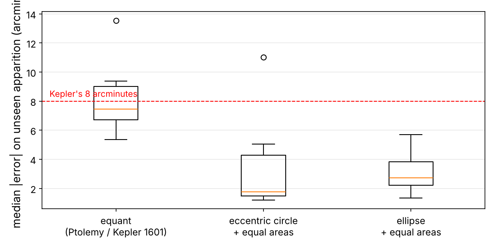</td>
<td>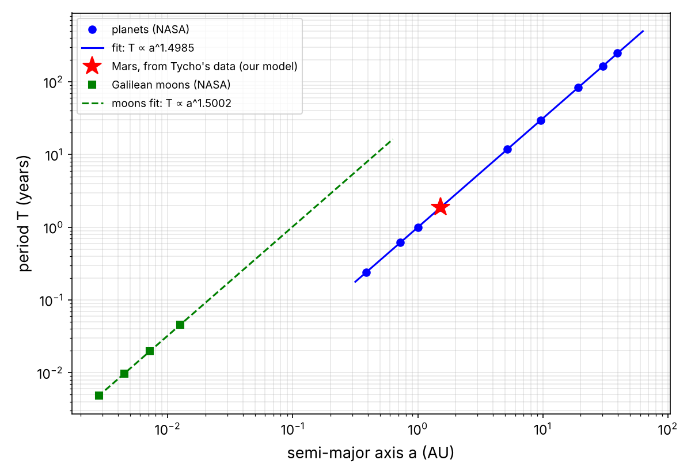</td>
</tr></table>

- Cleaned **940** naked-eye declinations of Mars: Latin timestamps, morning/evening markers, Julian vs Gregorian calendars.
- Triangulated Mars's orbit with Kepler's own 687-day trick and fit a conic with linear regression → **an ellipse with the Sun at a focus** (Law 1). Engineered ½ r² dθ/dt → **equal areas** (Law 2).
- Wrote a scikit-learn estimator for four historical world models (circle, equant, eccentric circle, ellipse) and compared them with `GroupKFold` across apparitions. The equant misses unseen data by **8.3 arcminutes**, the error that made Kepler abandon it.
- Log–log regression on NASA planetary data → **T² ∝ a³** (Law 3); the same fit weighs Jupiter from its moons. Then monitored the 1600 model for four centuries of drift.

## 2. Weighing the black hole at the centre of the Milky Way

<table><tr>
<td>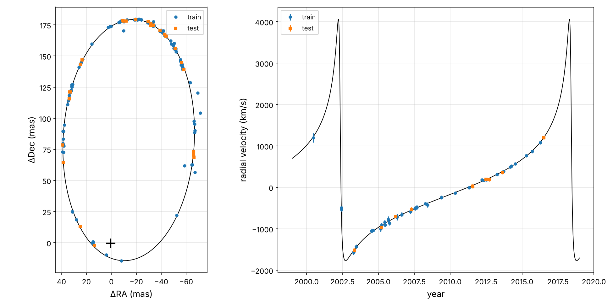</td>
<td>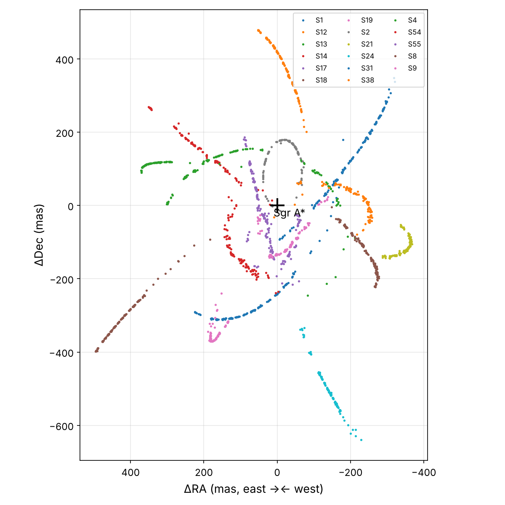</td>
</tr></table>

- Stratified the test set on distance to Sgr A\*, so the rare close passes are kept.
- Local polynomial regression shows every star accelerating towards one invisible point, falling off as **1/r²**.
- A custom transformer plus a **13-parameter Kepler-orbit estimator**, compared with polynomial baselines by cross-validation and a 5-year forecast; error floors tuned with `GridSearchCV`; uncertainties from the **bootstrap**, which exposes the mass–distance degeneracy.
- Result: **4.5 million solar masses at 8.5 kpc** from S2 alone. Seven other stars independently follow Kepler's third law with the same mass. The model then predicts S2's 2018 pericentre passage.

## 3. Rediscovering Neptune from the motion of Uranus

<table><tr>
<td>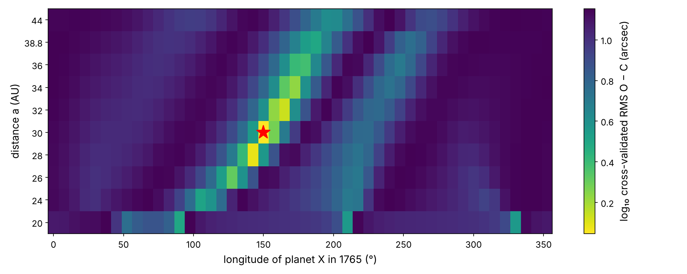</td>
<td>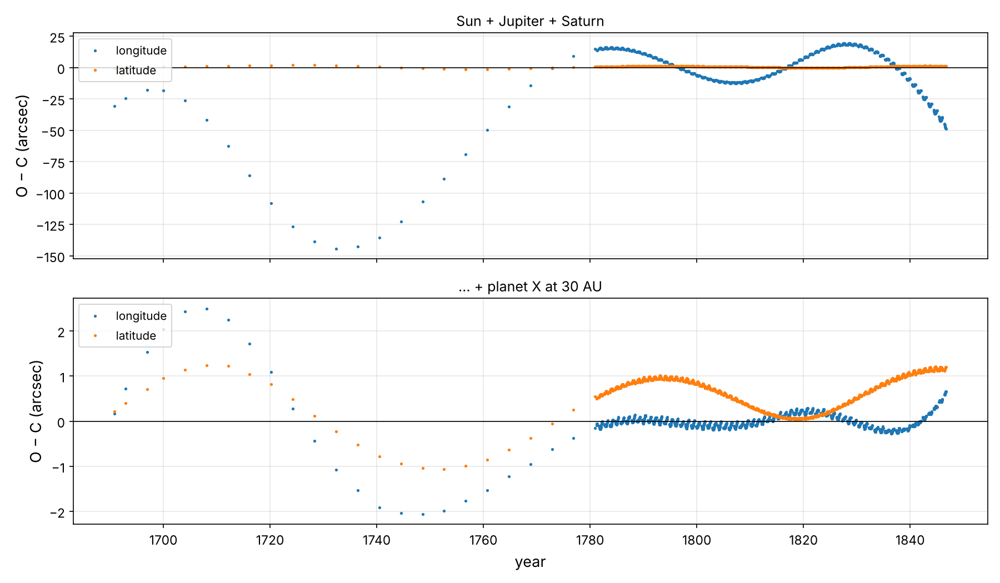</td>
</tr></table>

- Built a **gravity simulator** (Newton plus SciPy numerical integration) wrapped as a scikit-learn estimator, and fit Uranus's orbit.
- Even with Jupiter and Saturn, the residuals stay at **12″ RMS** with 2.4′ waves: the problem astronomers faced in the 1840s.
- Linearised the unknown planet's pull with a custom `PlanetXFeatures` transformer in a `Pipeline`, and ran **`GridSearchCV`** over its distance and longitude.
- Result: a planet at **30 AU, ~16 Earth masses**; residuals drop to ~0.5″, and the prediction for 23 Sept 1846 lies **~1.4° from Neptune**. The data overrule the Titius–Bode "law".

## 4. Discovering dark energy: the accelerating Universe

<table><tr>
<td>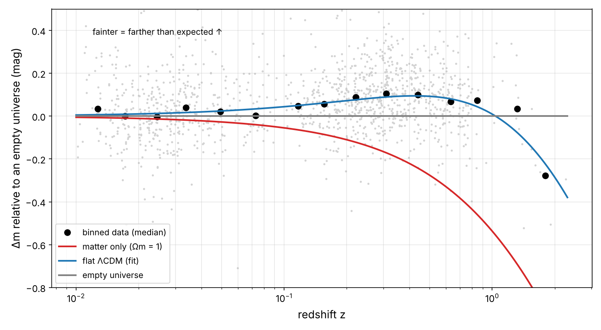</td>
<td>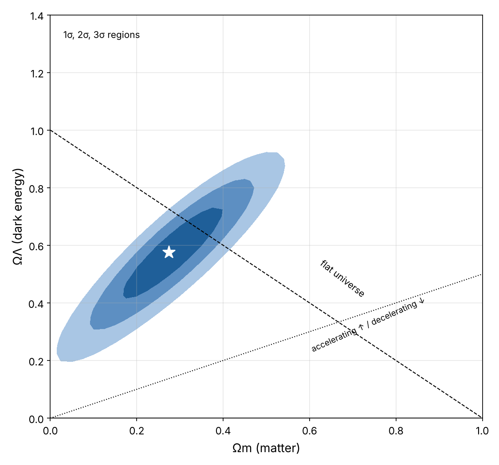</td>
</tr></table>

- Split 1,701 supernovae with **`StratifiedGroupKFold`**, because the same supernova appears in several surveys (group leakage).
- A two-feature regression on light-curve stretch and colour halves the scatter: a standard candle.
- A cosmology estimator learns the supernova luminosity and H₀ through the **distance ladder**; five universes compared with Δχ², `GroupKFold` and a k-NN baseline; the full covariance matrix used in generalised least squares; errors from a group bootstrap.
- Result: **H₀ ≈ 73.7 km/s/Mpc, Ωm ≈ 0.32, ΩΛ ≈ 0.68, q₀ ≈ −0.5**. A matter-only universe is excluded by **Δχ² ≈ 550**.

## 5. Hunting exoplanets in NASA Kepler data

<table><tr>
<td>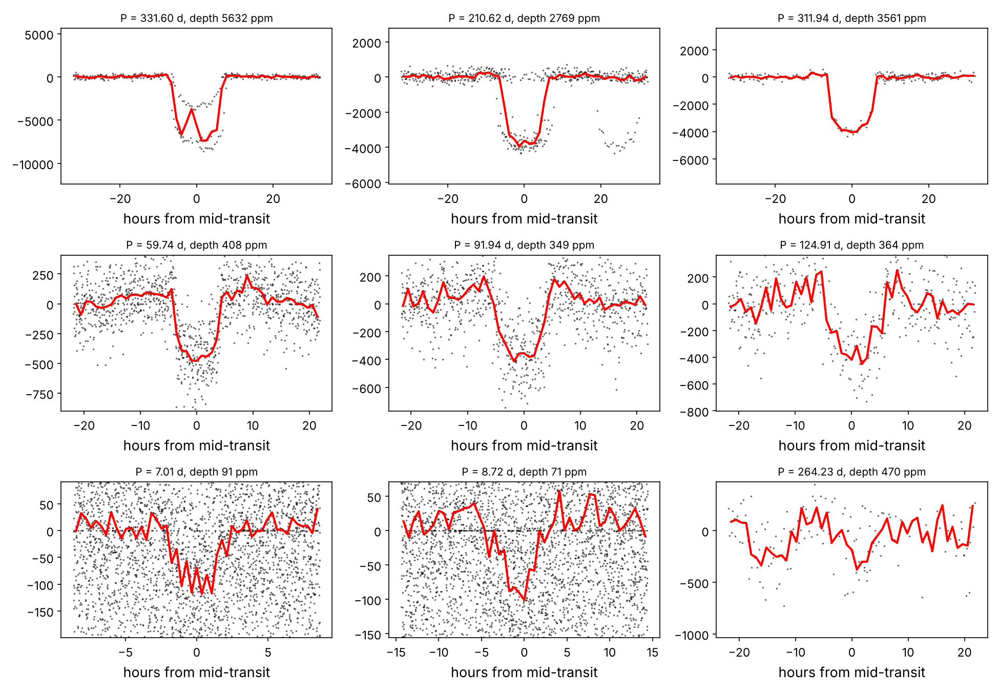</td>
<td>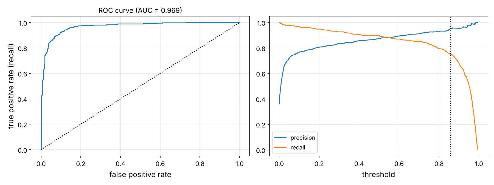</td>
</tr></table>

- Split the KOI catalog by star and held Kepler-90 out entirely for the final test.
- Engineered a physics feature: observed ÷ expected transit duration from Kepler's third law.
- Caught **target leakage**: the catalog's vetting flags give a fake "99.4%" model.
- Compared logistic regression, random forest and gradient boosting in a `Pipeline` + `ColumnTransformer`, tuned with `RandomizedSearchCV`, and chose the threshold from precision/recall.
- Detrended the raw light curve with a custom transformer and ran an iterative **Box Least Squares** search: **7 of Kepler-90's 8 planets** found and vetted as planets (test ROC AUC **0.97**). A quarter-edge artefact exposed an out-of-distribution failure, fixed with a guard rail.

## 6. The pacemaker of the ice ages

<table><tr>
<td>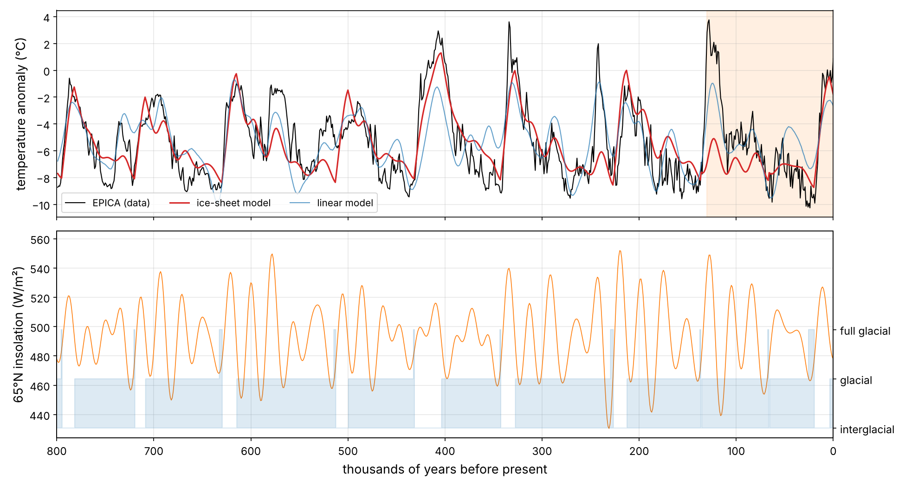</td>
<td>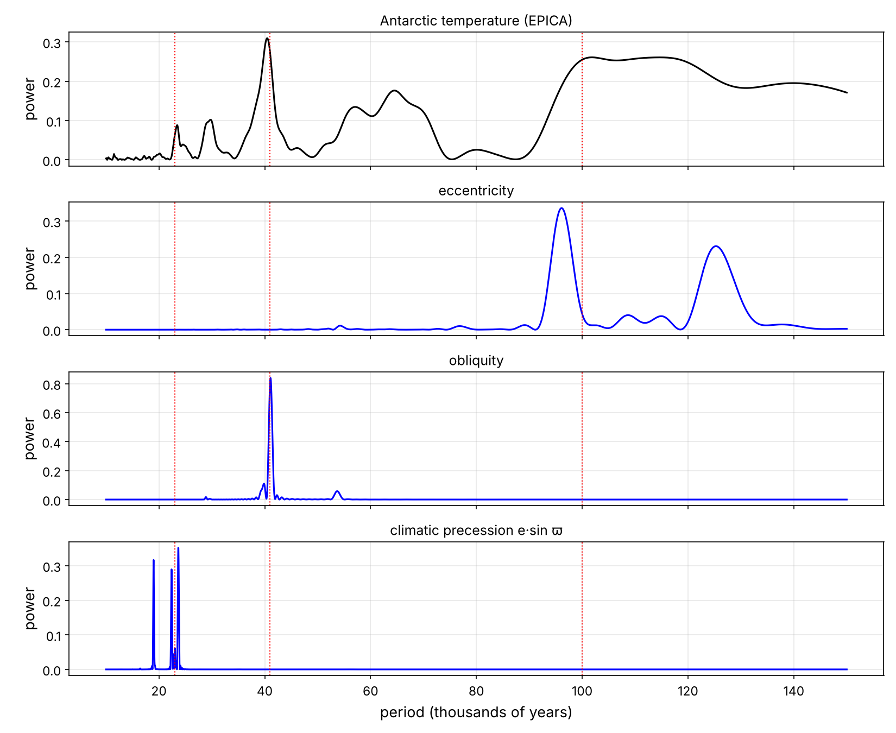</td>
</tr></table>

- Resampled the unevenly spaced ice core and held out the **last glacial cycle** as a time-series test set.
- Lomb–Scargle periodograms recover the **41, ~100 and 23 thousand-year** orbital cycles.
- Engineered **65°N summer insolation** from eccentricity, obliquity and precession, plus lag features; a linear model and gradient boosting (which overfits) compared with **blocked cross-validation**.
- Tuned a non-differentiable three-state **ice-sheet model** with `RandomizedSearchCV`; it reproduces the timing of the glacial terminations, then forecasts the next ice age and flags two drifts: the Mid-Pleistocene Transition and today's CO₂, far outside the training range.

---

## Repository layout

Each project folder contains:

- a Jupyter notebook that reproduces every number and figure,
- `images/`: the figures,
- `datasets/`: cached copies of the data, so everything runs offline,
- `animations/`: an interactive HTML animation driven by the fitted model (open it in a browser).

## Running the projects

```bash
python3 -m pip install -U jupyter numpy pandas matplotlib scipy scikit-learn astropy astroquery
jupyter notebook
```

## Data sources

Tycho Brahe, *Opera Omnia* (ed. Dreyer; transcription by W. Pafko); NASA/JPL Horizons; NASA NSSDC fact sheets; Gillessen et al. (2017), ApJ 837, 30; Pantheon+ (Scolnic et al. 2022; Brout et al. 2022) with SH0ES (Riess et al. 2022); NASA MAST and the NASA Exoplanet Archive; EPICA Dome C (Jouzel et al. 2007), Bereiter et al. (2015), LR04 (Lisiecki & Raymo 2005), La2004 (Laskar et al. 2004).
